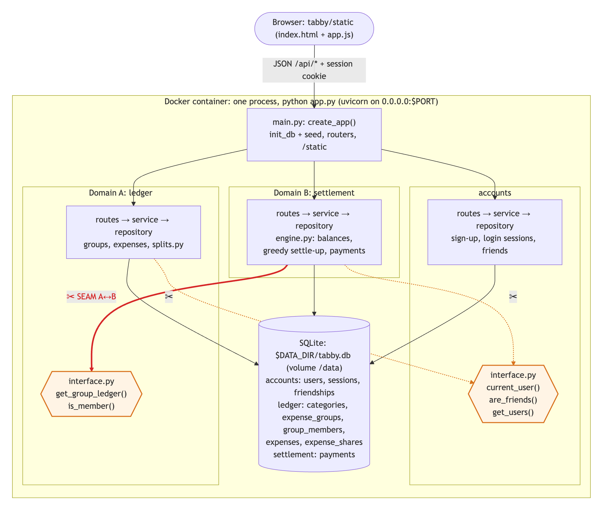
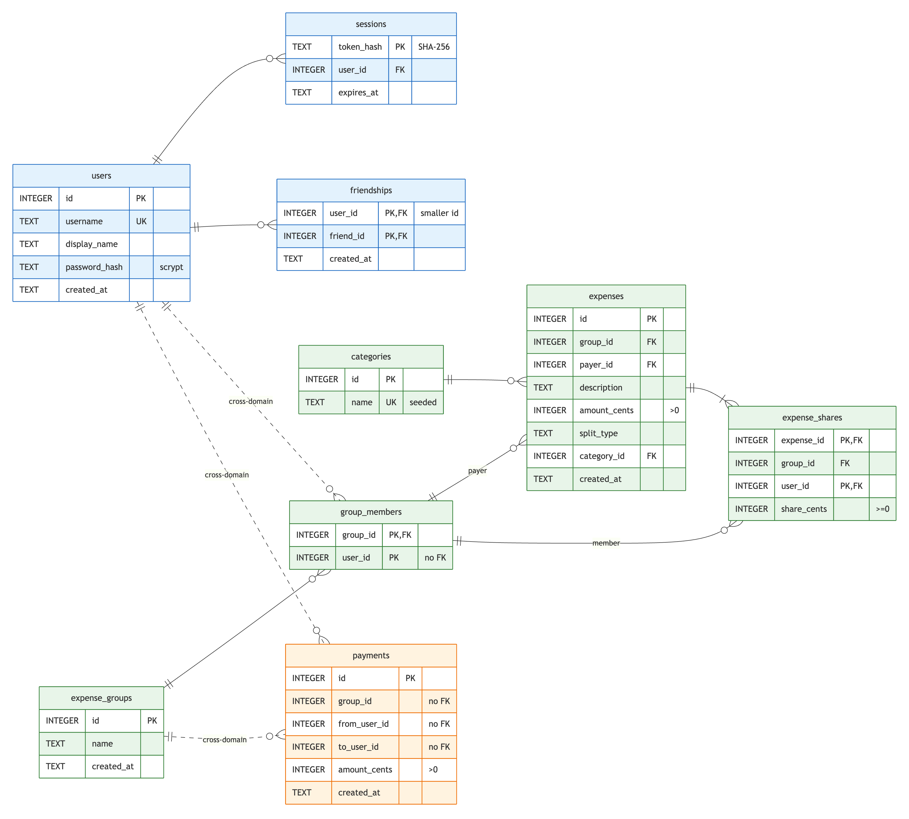

# Tabby

Tabby helps flatmates and trip groups log shared expenses and settle up with the fewest possible transfers. You sign up once, stay logged in, add your friends, put them in groups (a flat, a trip) and record who paid for what.

It is a single Python process (FastAPI + uvicorn) with a SQLite database, built for SDD Individual Assignment 1.

## Run locally

Requires Python 3.12 or newer.

```bash
python3 -m venv .venv
source .venv/bin/activate
pip install -r requirements.txt
python app.py
```

Then open <http://localhost:8000/>, sign up, and add a friend by username (sign up a second account in a private window to try it alone). The interactive API docs are at <http://localhost:8000/docs>.

No setup step is needed: on first start the app creates its data directory, the SQLite file and any missing tables.

## Configuration

Everything is configured through environment variables. None are required.

| Variable | Default | Purpose |
|---|---|---|
| `PORT` | `8000` | Port the HTTP server listens on. The server always binds `0.0.0.0`. |
| `DATA_DIR` | `./data` (next to `app.py`) | Directory that holds the SQLite file. The container sets it to `/data`. |
| `SESSION_DAYS` | `30` | How long a login is remembered (lifetime of the session cookie and its database row). |

Example: `PORT=9000 DATA_DIR=/tmp/tabby python app.py`

## Database

- SQLite file: `$DATA_DIR/tabby.db` (locally `./data/tabby.db`, in the container `/data/tabby.db`).
- Schema: one `schema.sql` per domain ([accounts](tabby/accounts/schema.sql), [ledger](tabby/ledger/schema.sql), [settlement](tabby/settlement/schema.sql)), applied on every boot. They only use `CREATE ... IF NOT EXISTS`, so existing tables and rows are never dropped or changed.
- The `.db` file is never committed; it is created at runtime.
- Seed data: the starter expense categories live in [`tabby/ledger/seed_categories.csv`](tabby/ledger/seed_categories.csv) and are inserted on boot only when the `categories` table is empty, so restarts never duplicate them.

## Run with Docker

The [Dockerfile](Dockerfile) is the course template with its four TODOs filled in.

```bash
docker build -t tabby .
docker run -p 8000:8000 -v tabby-data:/data tabby
```

The database is written to `/data/tabby.db` inside the named volume `tabby-data`, so it survives `docker rm`. To use another port: `docker run -e PORT=9000 -p 9000:9000 -v tabby-data:/data tabby`.

## Architecture



One process serves the frontend and the JSON API. Each domain (`accounts`, `ledger` = Domain A, `settlement` = Domain B) is a package with its own routes, service, repository and tables, and other domains may only call its `interface.py` (ADR-2). **The seam between Domain A and Domain B is `ledger.interface.get_group_ledger()`** (red arrow): settlement never reads ledger tables, so in Assignment 2 that one call becomes `GET /groups/{id}/ledger` on a separate ledger service. Source: [docs/architecture.mmd](docs/architecture.mmd).

## Database schema



All tables live in one SQLite file, colour-coded by the domain that owns them (blue: accounts, green: ledger, orange: settlement). Solid lines are real foreign keys inside a domain; dashed lines are ids that cross a domain boundary and deliberately have no foreign key (ADR-2, ADR-3). Source: [docs/database.mmd](docs/database.mmd).

## API overview

All endpoints are under `/api` and documented interactively at `/docs`. Everything except sign-up and login needs the `tabby_session` cookie that those two set.

| Domain | Endpoints |
|---|---|
| Accounts | `POST /api/signup`, `POST /api/login`, `POST /api/logout`, `GET /api/me`, `GET/POST /api/friends` |
| Ledger (Domain A) | `GET /api/categories`, `GET/POST /api/groups`, `GET /api/groups/{id}`, `POST /api/groups/{id}/members`, `DELETE /api/groups/{id}/members/{user_id}`, `GET/POST /api/groups/{id}/expenses`, `DELETE /api/groups/{id}/expenses/{expense_id}`, `GET /api/groups/{id}/spending` |
| Settlement (Domain B) | `GET /api/groups/{id}/settlement` (balances + suggested transfers), `GET/POST /api/groups/{id}/payments` |

Money is always sent and stored as integer cents (`amount_cents`). An expense's `split_type` is `equal`, `shares` (each participant's `value` is a weight) or `exact` (each `value` is cents owed, and they must add up to the amount).

## Project structure

```
app.py                 entry point: python app.py
tabby/
  config.py            settings from environment variables
  db.py                SQLite connection + first-boot schema creation
  errors.py            domain errors -> HTTP status codes
  main.py              builds the FastAPI app and registers each domain's routes
  accounts/            users, login sessions, friends
  ledger/              Domain A: groups, members, expenses, split rules, category seed
  settlement/          Domain B: balances, greedy settle-up plan, recorded payments
  static/              frontend: index.html, app.js, style.css (served at /)
tests/                 pytest unit tests (not copied into the Docker image)
```

Each domain has `routes.py` (HTTP), `service.py` (business rules), `repository.py` (SQL), `schema.sql` (its tables) and `interface.py`, the only module other domains may import (see ADR-2).

## Tests and coverage

Tests cover the business logic of all three domains: the pure functions (split rounding, settle-up algorithm, password hashing) and the services against a fresh temporary SQLite file per test. See ADR-4.

```bash
python -m pytest --cov=tabby --cov-report=term-missing
```

Result (final code): **422 passed, 94% coverage** of the whole `tabby` package. The uncovered lines are HTTP glue (route bodies, the cookie check, the per-request connection).

```
Name                             Stmts   Miss  Cover
----------------------------------------------------
tabby/accounts/interface.py         16      5    69%
tabby/accounts/models.py            14      0   100%
tabby/accounts/repository.py        24      0   100%
tabby/accounts/routes.py            36     16    56%
tabby/accounts/security.py          25      0   100%
tabby/accounts/service.py           59      0   100%
tabby/config.py                     18      0   100%
tabby/db.py                         24      4    83%
tabby/errors.py                     12      0   100%
tabby/ledger/interface.py           20      0   100%
tabby/ledger/models.py              40      0   100%
tabby/ledger/repository.py          37      0   100%
tabby/ledger/routes.py              38     10    74%
tabby/ledger/seed.py                12      0   100%
tabby/ledger/service.py             83      0   100%
tabby/ledger/splits.py              37      0   100%
tabby/main.py                       32      2    94%
tabby/settlement/engine.py          42      0   100%
tabby/settlement/models.py          20      0   100%
tabby/settlement/repository.py       5      0   100%
tabby/settlement/routes.py          16      3    81%
tabby/settlement/service.py         33      0   100%
----------------------------------------------------
TOTAL                              643     40    94%
```

## Container contract check (§7)

`run.sh` is the checker provided in the course repository ([ami232/sdd-assignment-1](https://github.com/ami232/sdd-assignment-1), folder `container/`). With Docker running:

```bash
./container/run.sh /path/to/this/repo
```

Final run, 2026-10-12, on the submitted code:

```
=== SDD Assignment 1 contract check ===
Repository: /Users/sergehagopian/Desktop/Software Devops Assignment 1

==> Repository shape
  PASS  one Dockerfile, one manifest (requirements.txt)

==> Build from a clean context, no build args
  PASS  image built
  PASS  image size 57 MB

==> Start on PORT=8000 and reach it from the host
  PASS  HTTP 200 from http://localhost:8000/

==> SQLite file under DATA_DIR
  PASS  found in /data: tabby.db 

==> Data persists, and a second boot does not re-seed
  PASS  volume at /data persists
  PASS  row counts unchanged across restart: categories=9 expense_groups=0 expense_shares=0 expenses=0 friendships=0 group_members=0 payments=0 sessions=0 users=0 

==> PORT override is honoured (not hardcoded)
  PASS  HTTP 200 from http://localhost:9123/

=== ALL CHECKS PASSED ===
Paste this output into your README as the §7 evidence.
```

## Project docs

- [ADR.md](ADR.md): architecture decision log
- [AI_USAGE.md](AI_USAGE.md): AI usage log
- [docs/architecture.mmd](docs/architecture.mmd), [docs/database.mmd](docs/database.mmd): diagram sources
- [docs/Tabby_Report.docx](docs/Tabby_Report.docx): the 4-5 page report
