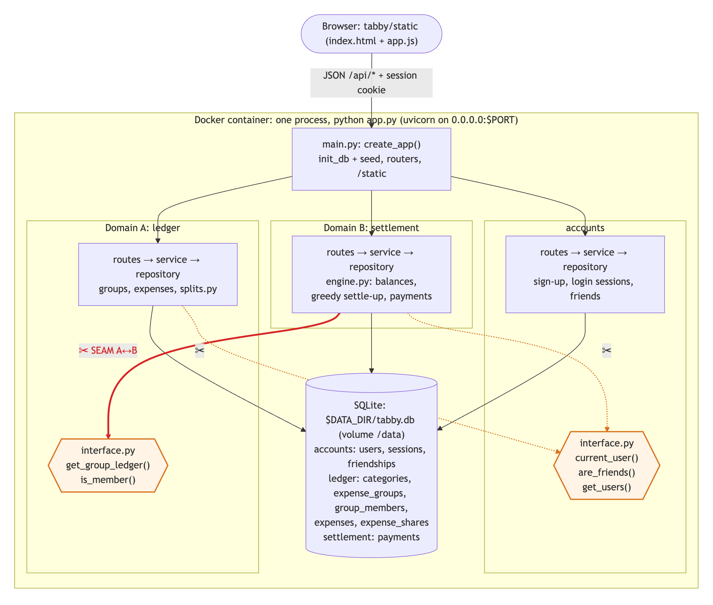
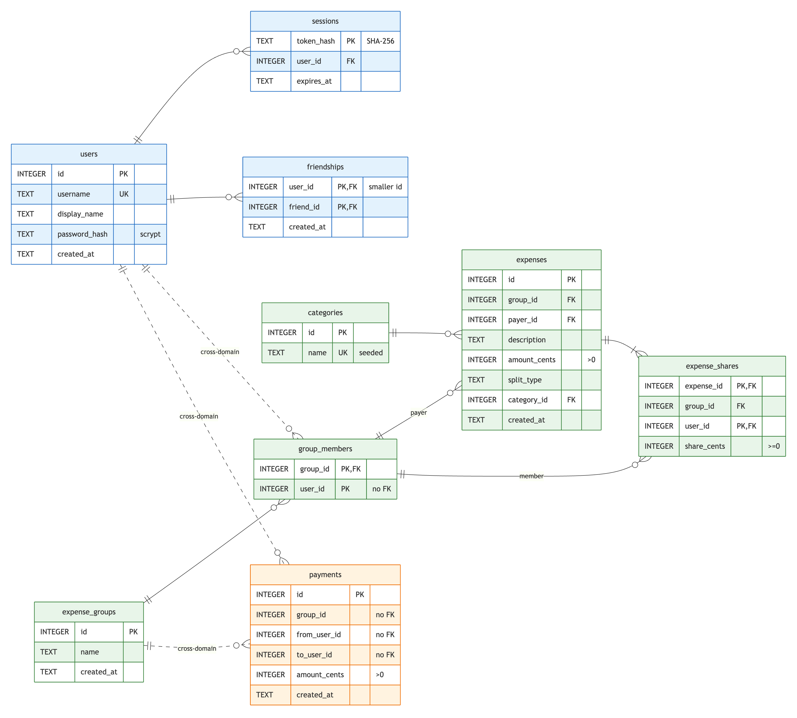

# Tabby

Tabby helps flatmates and trip groups log shared expenses and settle up with the fewest possible transfers. You sign up once, stay logged in, add your friends, put them in groups (a flat, a trip) and record who paid for what.

It is two Python services (FastAPI + uvicorn), each with its own SQLite database, plus a static frontend. It started as the single-process app of SDD Individual Assignment 1 and was split along its domain seam for Assignment 2 (ADR-6).

| Service | Folder | Owns | Image |
|---|---|---|---|
| `ledger` | [services/ledger](services/ledger) | accounts (users, sessions, friends) and Domain A (groups, expenses) | `ghcr.io/sergegod/tabby-ledger:<commit sha>` |
| `settlement` | [services/settlement](services/settlement) | Domain B (balances, settle-up plan, payments) | `ghcr.io/sergegod/tabby-settlement:<commit sha>` |
| `ui` | [ui](ui) | static HTML/JS/CSS | none (served by nginx locally) |

## Run the whole system

Requires Docker.

```bash
docker compose up --build
```

Then open <http://localhost:8080/>, sign up, and add a friend by username (sign up a second account in a private window to try it alone). nginx serves the frontend and forwards `/api/groups/{id}/settlement` and `/api/groups/{id}/payments` to the settlement service and every other `/api` path to the ledger service ([ui/nginx.conf](ui/nginx.conf)).

No setup step is needed: on first start each service creates its data directory, its SQLite file and any missing tables.

## Run one service without Docker

Requires Python 3.12 or newer.

```bash
cd services/ledger            # or services/settlement
python3 -m venv .venv
source .venv/bin/activate
pip install -r requirements.txt -r requirements-dev.txt
python app.py
```

The interactive API docs of that service are at <http://localhost:8000/docs>.

## Configuration

Everything is configured through environment variables. None are required.

| Variable | Service | Default | Purpose |
|---|---|---|---|
| `PORT` | both | `8000` | Port the HTTP server listens on. The server always binds `0.0.0.0`. |
| `DATA_DIR` | both | `./data` (next to `app.py`) | Directory that holds the SQLite file. The containers set it to `/data`. |
| `SESSION_DAYS` | ledger | `30` | How long a login is remembered (lifetime of the session cookie and its database row). |
| `LEDGER_URL` | settlement | `http://localhost:8001` | Base URL of the ledger service. docker compose sets it to `http://ledger:8000`. |

## Database

- Each service has its own SQLite file and never opens the other's: `$DATA_DIR/tabby.db` for ledger (accounts and ledger tables) and `$DATA_DIR/settlement.db` for settlement (`payments`).
- Schema: one `schema.sql` per domain ([accounts](services/ledger/tabby/accounts/schema.sql), [ledger](services/ledger/tabby/ledger/schema.sql), [settlement](services/settlement/tabby/settlement/schema.sql)), applied on every boot. They only use `CREATE ... IF NOT EXISTS`, so existing tables and rows are never dropped or changed.
- The `.db` files are never committed; they are created at runtime.
- Seed data: the starter expense categories live in [`seed_categories.csv`](services/ledger/tabby/ledger/seed_categories.csv) and are inserted on boot only when the `categories` table is empty, so restarts never duplicate them.

## CI and images

[.github/workflows/ci.yml](.github/workflows/ci.yml) runs on every push and pull request:

1. `test`: for each service, `ruff check .` and `pytest` (fails under 70% coverage).
2. `images`: only if `test` passed, builds the Docker image of each service. On `main` it also pushes the image to GHCR, tagged with the commit SHA and never `latest`, so a tag always names exactly one build.

```bash
docker run --rm -p 8000:8000 ghcr.io/sergegod/tabby-ledger:<commit sha>
```

## Architecture



The diagram shows the three domains as drawn for Assignment 1, when they ran in one process. The red arrow, **the seam between Domain A and Domain B**, is now a network call: the settlement service asks the ledger service `GET /api/groups/{id}/ledger` ([ledger_client.py](services/settlement/tabby/ledger_client.py)) and forwards the user's session cookie, so the ledger service decides who the caller is and what they may see. Settlement never reads ledger tables. Source: [docs/architecture.mmd](docs/architecture.mmd).

## Database schema



Tables are colour-coded by the domain that owns them (blue: accounts, green: ledger, orange: settlement). Blue and green live in the ledger service's database, orange in the settlement service's. Solid lines are real foreign keys inside a domain; dashed lines are ids that cross a domain boundary and deliberately have no foreign key (ADR-2, ADR-3). Source: [docs/database.mmd](docs/database.mmd).

## API overview

All endpoints are under `/api` and documented interactively at `/docs`. Everything except sign-up and login needs the `tabby_session` cookie that those two set.

| Domain | Endpoints |
|---|---|
| Accounts | `POST /api/signup`, `POST /api/login`, `POST /api/logout`, `GET /api/me`, `GET/POST /api/friends` |
| Ledger (Domain A) | `GET /api/groups/{id}/ledger` (called by settlement), `GET /api/categories`, `GET/POST /api/groups`, `GET /api/groups/{id}`, `POST /api/groups/{id}/members`, `DELETE /api/groups/{id}/members/{user_id}`, `GET/POST /api/groups/{id}/expenses`, `DELETE /api/groups/{id}/expenses/{expense_id}`, `GET /api/groups/{id}/spending` |
| Settlement (Domain B) | `GET /api/groups/{id}/settlement` (balances + suggested transfers), `GET/POST /api/groups/{id}/payments` |

Money is always sent and stored as integer cents (`amount_cents`). An expense's `split_type` is `equal`, `shares` (each participant's `value` is a weight) or `exact` (each `value` is cents owed, and they must add up to the amount).

## Project structure

```
.github/workflows/ci.yml   test and images jobs
docker-compose.yml         ledger + settlement + nginx for local runs
services/
  ledger/
    Dockerfile, app.py, requirements*.txt
    tabby/accounts/        users, login sessions, friends
    tabby/ledger/          Domain A: groups, members, expenses, split rules, category seed
    tests/
  settlement/
    Dockerfile, app.py, requirements*.txt
    tabby/ledger_client.py HTTP client for the ledger service (the seam)
    tabby/settlement/      Domain B: balances, greedy settle-up plan, recorded payments
    tests/
ui/                        frontend: index.html, app.js, style.css, nginx.conf
```

Each domain has `routes.py` (HTTP), `service.py` (business rules), `repository.py` (SQL) and `schema.sql` (its tables).

## Tests and coverage

Each service has its own test suite: pure functions (split rounding, settle-up algorithm, password hashing), services against a fresh temporary SQLite file per test, and the HTTP API through FastAPI's `TestClient`. The settlement tests never start a ledger service: they use a fake one (see ADR-4 and ADR-6).

```bash
cd services/ledger && pytest --cov=tabby        # 361 passed, 97% coverage
cd services/settlement && pytest --cov=tabby    # 75 passed, 99% coverage
```

## Project docs

- [ADR.md](ADR.md): architecture decision log
- [AI_USAGE.md](AI_USAGE.md): AI usage log
- [docs/architecture.mmd](docs/architecture.mmd), [docs/database.mmd](docs/database.mmd): diagram sources
- [docs/Tabby_Report.docx](docs/Tabby_Report.docx): the 4-5 page report
