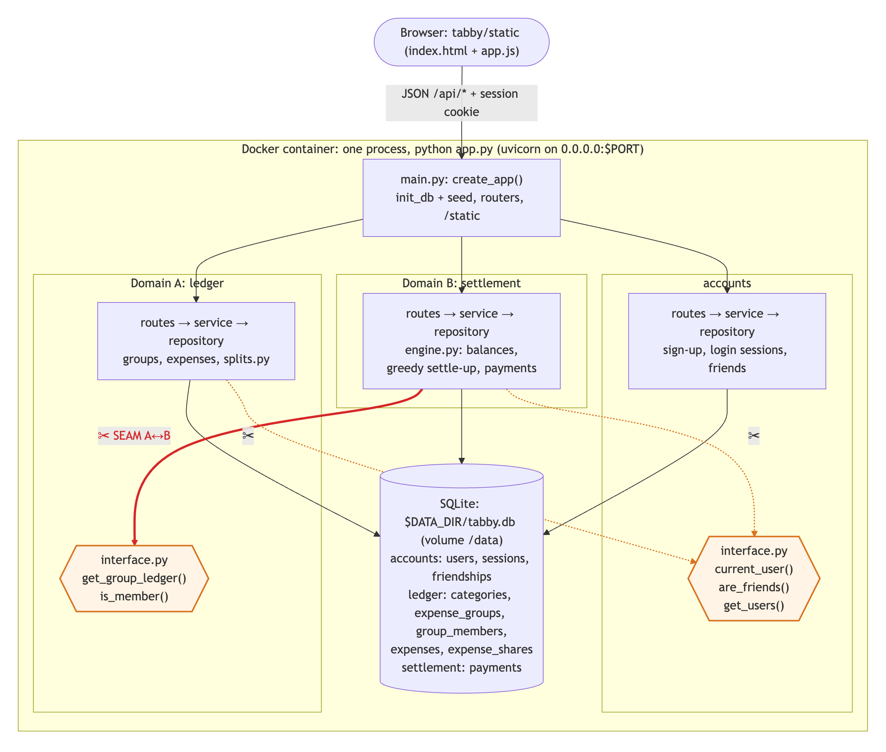
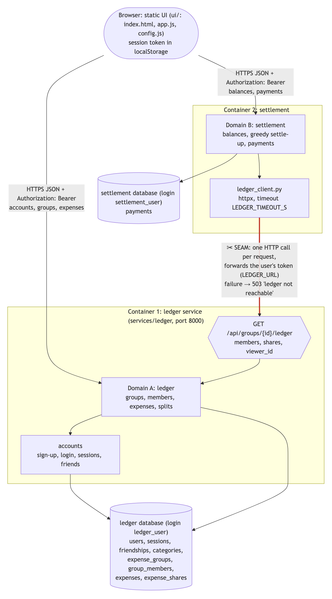
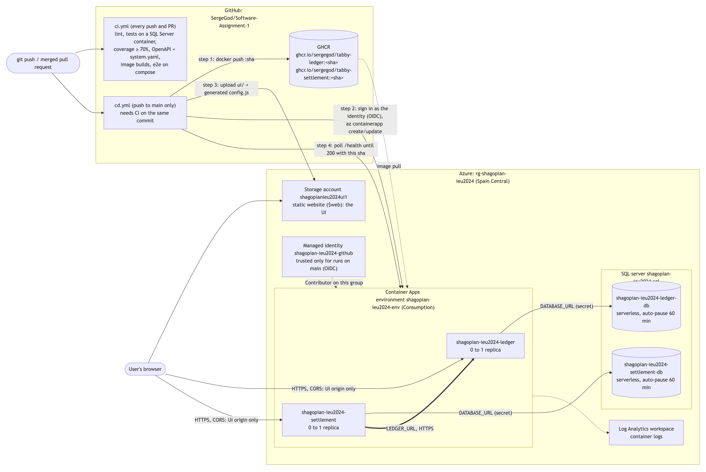
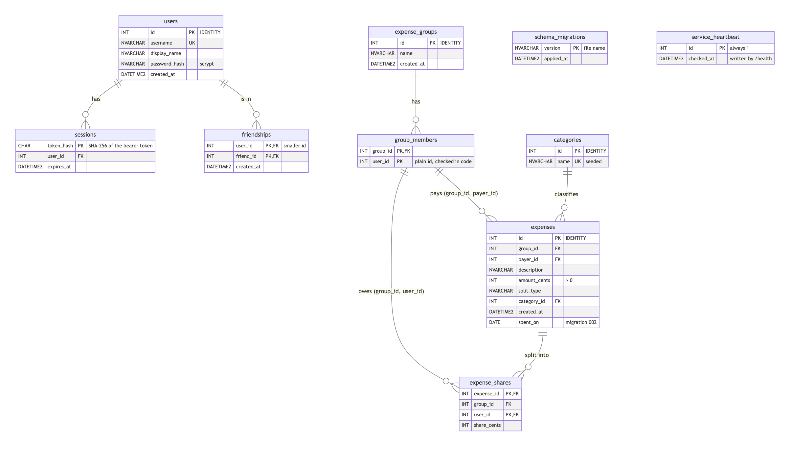
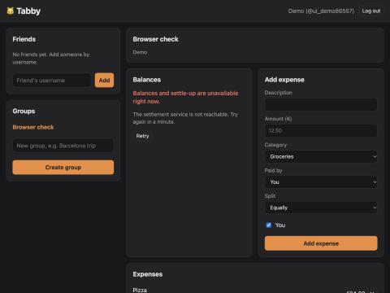

Repository: <https://github.com/SergeGod/Software-Assignment-1> · graded commit: tag `submission` on `main`.

**Live URL: <https://shagopianieu2024ui1.z43.web.core.windows.net>**

**Lateness, stated plainly.** The services, databases, compose stack, tests and CI were finished by 23 November. The Azure deployment, migration 002, ADR-9, ADR-10 and this report were done on 25 November, one day after the deadline; no commit was backdated. Part of the delay was mine: I had built the Azure side against an earlier version of §7 (shared class subscription, service principal) and reworked it on the 25th for my own Azure for Students subscription and the OpenID Connect identity.

# 1. Architecture, before and after

Assignment 1 was one process and one SQLite file. The three packages (`accounts`, `ledger`, `settlement`) only imported each other's `interface.py`, and ADR-2 named the cut: settlement reads the ledger through `get_group_ledger()`.

{width=62%}

Assignment 2 cuts exactly there (ADR-6). `ledger` keeps accounts and Domain A; `settlement` keeps Domain B. The function call became one HTTP call per request, `GET {LEDGER_URL}/api/groups/{id}/ledger`, to which settlement forwards the user's bearer token. Ledger checks the token and the membership and answers with the members, each expense's shares and `viewer_id`. Accounts stayed with ledger because every ledger rule needs the user; in settlement it would have forced a call across the seam on every ledger request. The cookie of Assignment 1 became a bearer token because the UI and the services are on different sites on Azure and a gateway would be a third container (ADR-10).

{width=50%}

# 2. Deployment

Every push runs `ci.yml`. A merge to `main` runs `cd.yml`, which first calls the same CI workflow and only then pushes both images to GHCR tagged with the commit SHA, signs in to Azure as the managed identity `shagopian-ieu2024-github` through OpenID Connect (no Azure secret is stored; the identity trusts only runs on `main` of this repository and has Contributor on the resource group only), deploys the images to Container Apps (0 to 1 replica, Consumption), uploads the UI with a generated `config.js` to the storage account's `$web` container, and polls each `/health` until it returns 200 with that SHA. The one-time setup is a script, `infra/setup-local.sh`. One deviation from §7: Azure refused the SQL free offer on my subscription (`ProvisioningDisabled`), so the two databases are the same serverless configuration (0.5 to 1 vCore, auto-pause 60 min) paid from the student credit (ADR-8). The storage account is `shagopianieu2024ui1` because the plain name was taken.

{width=100%}

# 3. Databases

Each service has its own database and its own login with access to that database only. Ids that cross the seam are plain integers without a foreign key; the check is done in code (settlement asks ledger whether both people are members before it stores a payment).

{width=88%}

{width=55%}

# 4. Migration evidence on Azure

The runner (`tabby/db.py:migrate`) applies the numbered files not yet in `schema_migrations`, each in one transaction with the row that records it, before the service opens its port. `002_add_expense_spent_on.sql` changes `expenses`, which already held rows: add `spent_on` as nullable, backfill it from `created_at` in a second batch, then make it `NOT NULL` with a default.

**Before** (commit `3c2f030` deployed, only migration 001; `docs/evidence/migration-002-azure-before.txt`, 19:34 UTC). `GET /api/groups/1/expenses` on the live ledger returned three expenses without a date field:

```
{"id": 3, "description": "Train tickets",    "amount_cents": 6200, "created_at": "2026-11-25T19:34:34"}
{"id": 2, "description": "Electricity bill", "amount_cents": 8450, "created_at": "2026-11-25T19:34:34"}
{"id": 1, "description": "Groceries",        "amount_cents": 3000, "created_at": "2026-11-25T19:34:20"}
```

**Deployment run** of the migration (commit `35e9383`): <https://github.com/SergeGod/Software-Assignment-1/actions/runs/45686882821>. Its "Startup logs" step shows the ledger container on Azure:

```
2026-11-25 19:38:42,009 INFO tabby.db applying migration 002_add_expense_spent_on.sql
2026-11-25 19:38:42,057 INFO tabby.db schema up to date: 1 migration(s) applied now, 2 in total
```

**After** (`migration-002-azure-after.txt`; `/health` reports version `35e9383…`): the same three rows, same ids and amounts, each now with its date.

```
{"id": 3, "description": "Train tickets",    "amount_cents": 6200, "spent_on": "2026-11-25"}
{"id": 2, "description": "Electricity bill", "amount_cents": 8450, "spent_on": "2026-11-25"}
{"id": 1, "description": "Groceries",        "amount_cents": 3000, "spent_on": "2026-11-25"}
```

The same migration was first run on the local stack, whose rows dated from 21 November and were backfilled with that date (`migration-002-local-*.txt`), and a unit test repeats it on every CI run.

# 5. Partial failure

Every call to ledger has a timeout (5 s locally, 20 s on Azure). On Azure both services start from zero, so the UI shows a "starting up, retrying" notice and retries reads for about a minute instead of a blank page. With `docker compose stop settlement`, ledger keeps serving groups and expenses and the UI replaces the balances card with a notice and a Retry button:

{width=70%}

With ledger stopped, settlement answers `503 {"detail": "the ledger service is not reachable, so balances cannot be shown right now. Try again in a minute."}` while its own `/health` stays 200, because health reports only the service's own database. CI checks both on the compose stack (`tests/e2e/cross_seam.py ledger-down`).

# 6. Pipeline evidence

CI runs on every push and pull request: lint, tests against a SQL Server container, coverage (gate 70%; measured 98% ledger, 96% settlement), OpenAPI and `system.yaml` validation, both image builds, and the end-to-end test.

Successful CD run on `main`: <https://github.com/SergeGod/Software-Assignment-1/actions/runs/45686882821> (CI, both images pushed with the SHA, both services and the UI deployed, both `/health` checks green on that SHA).

Failed run that was fixed: <https://github.com/SergeGod/Software-Assignment-1/actions/runs/45685648955>, attempt 1. CI and the image pushes passed, and `azure/login` failed with `AADSTS700213: No matching federated identity record found for presented assertion subject 'repo:SergeGod@194789741/Software-Assignment-1@1410389459:ref:refs/heads/main'`. Cause: the identity's federated credential had been created with the subject `repo:SergeGod/Software-Assignment-1:ref:refs/heads/main`, but GitHub's token carries the numeric owner and repository ids. Fix: the credential was recreated with the exact subject (and `infra/setup.sh` now reads the ids from the GitHub API); attempt 2 of the same run deployed successfully. An earlier run, <https://github.com/SergeGod/Software-Assignment-1/actions/runs/45625378611>, failed at the same step because no Azure credentials existed yet.

# 7. Decisions in short

ADR-6 the split and the bearer token; ADR-7 numbered SQL migrations, integrity at the seam in code, recovery by a new migration file or point-in-time restore; ADR-8 scale-to-zero hosting, cold starts and error 40613 handled with backoff of about 2.5 minutes, one replica so migrations never run twice; ADR-9 what CI gates on and the two cross-seam tests (a stub checked against ledger's OpenAPI file, plus the real compose stack); ADR-10 the gateway that was not built and when it would be.

# 8. AI disclosure

I acknowledge the use of Claude Code (Anthropic, models Claude Opus 5.5 and Claude Fable 5.2) to propose design options, generate the service code, migrations, tests, Dockerfiles, compose file, workflows, Azure scripts, diagrams and the drafts of ADR 6 to 10 and of this report, and to run and verify the system locally and on Azure. I ran the Azure setup commands myself. The prompts used include "split Tabby into ledger and settlement services with their own Dockerfiles and tests", "finish the service side: SQL Server with versioned migrations, bearer token, /health, request logs, CORS, compose, CI", "write the one-time Azure setup and the CD workflow" and "finish the assignment: a migration that changes a table holding data, the UI deployment, ADR-9 and ADR-10, the diagrams and the report" and "rework the Azure setup for my own Azure for Students subscription with an OpenID Connect identity". The output of these prompts was used to build the code base and its documentation; the decision to keep accounts inside the ledger service was mine. Each interaction is logged in AI_USAGE.md.
