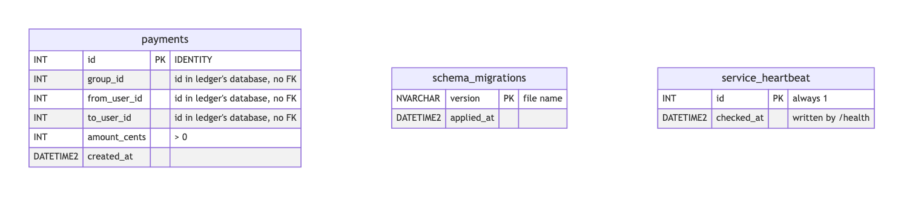

Repository: <https://github.com/SergeGod/Software-Assignment-1> · graded commit: tag `submission` on `main`.

**Status, stated plainly.** The two services, their databases, the migrations, the compose stack, the tests and the CI pipeline are complete and pass. The CD pipeline and the Azure scripts are written and pass CI, but **the system is not deployed on Azure**: the class service principal was not in the repository secrets when this report was written, so no CD run has reached Azure. There is therefore no live URL, and the migration and pipeline evidence below is from the local compose stack and from CI, not from Azure. The last part of the work (migration 002, UI deployment, ADR-9, ADR-10, this report) was done on 25 November, one day after the deadline; no commit was backdated.

# 1. Architecture, before and after

Assignment 1 was one process and one SQLite file. The three packages (`accounts`, `ledger`, `settlement`) only imported each other's `interface.py`, and ADR-2 named the cut: settlement reads the ledger through `get_group_ledger()`.

{width=62%}

Assignment 2 cuts exactly there (ADR-6). `ledger` keeps accounts and Domain A; `settlement` keeps Domain B. The function call became one HTTP call per request, `GET {LEDGER_URL}/api/groups/{id}/ledger`, to which settlement forwards the user's bearer token. Ledger checks the token and the membership and answers with the members, each expense's shares and `viewer_id`. Accounts stayed with ledger because every ledger rule needs the user; in settlement it would have forced a call across the seam on every ledger request. The cookie of Assignment 1 became a bearer token because the UI and the services are on different sites on Azure and a gateway would be a third container (ADR-10).

{width=50%}

# 2. Deployment

Every push runs `ci.yml`. A merge to `main` runs `cd.yml`, which first calls the same CI workflow and only then pushes both images to GHCR tagged with the commit SHA, deploys them to Container Apps (0 to 1 replica, Consumption), uploads the UI with a generated `config.js`, and polls each `/health` until it returns 200 with that SHA. The one-time setup (`infra/setup.sh`, `azure-setup.yml`) creates the SQL server, the two serverless databases (GP Gen5, 0.5 to 1 vCore, auto-pause 15 min, 2 GB), the environment and the storage account. The assignment text names Static Web Apps for the UI while `system.schema.json` requires `ui.storage_account`; I followed the schema (ADR-8).

{width=100%}

# 3. Databases

Each service has its own database and its own login with access to that database only. Ids that cross the seam are plain integers without a foreign key; the check is done in code (settlement asks ledger whether both people are members before it stores a payment).

{width=88%}

{width=55%}

# 4. Migration evidence

The runner (`tabby/db.py:migrate`) applies the numbered files not yet in `schema_migrations`, each in one transaction with the row that records it, before the service opens its port. `002_add_expense_spent_on.sql` changes `expenses`, which already held rows: add `spent_on` as nullable, backfill it from `created_at` in a second batch, then make it `NOT NULL` with a default.

**Not on Azure** (see status above). On the local stack, whose ledger database had been running since 21 November:

Before (`docs/evidence/migration-002-local-before.txt`):

```
001_init.sql 2026-11-21 20:15:48
id group_id payer_id description amount_cents ... created_at
3  3        4        Groceries   3000             2026-11-25 12:58:19
2  2        3        Pizza       2400             2026-11-21 20:16:26
1  1        1        Groceries   3000             2026-11-21 20:16:15
```

Startup log of the new image, then of a restart:

```
INFO tabby.db applying migration 002_add_expense_spent_on.sql
INFO tabby.db schema up to date: 1 migration(s) applied now, 2 in total
INFO tabby.db schema up to date: 0 migration(s) applied now, 2 in total
```

After (`migration-002-local-after.txt`): the same three rows, each with its date.

```
002_add_expense_spent_on.sql 2026-11-25 13:00:40
id ... description amount_cents created_at          spent_on
3      Groceries   3000         2026-11-25 12:58:19 2026-11-25
2      Pizza       2400         2026-11-21 20:16:26 2026-11-21
1      Groceries   3000         2026-11-21 20:16:15 2026-11-21
```

A unit test repeats this on every CI run: it rewinds the test database to 001, inserts an expense the old way, migrates and checks the row.

# 5. Partial failure

Every call to ledger has a timeout (5 s locally, 20 s on Azure). With `docker compose stop settlement`, ledger keeps serving groups and expenses and the UI replaces the balances card with a notice and a Retry button:

{width=70%}

With ledger stopped, settlement answers `503 {"detail": "the ledger service is not reachable, so balances cannot be shown right now. Try again in a minute."}` while its own `/health` stays 200, because health reports only the service's own database. CI checks both on the compose stack (`tests/e2e/cross_seam.py ledger-down`).

# 6. Pipeline evidence

CI runs on every push and pull request: lint, tests against a SQL Server container, coverage (gate 70%; measured 98% ledger, 96% settlement), OpenAPI and `system.yaml` validation, both image builds, and the end-to-end test. Example of a green run on a pull request: <https://github.com/SergeGod/Software-Assignment-1/actions/runs/45619521037>.

A successful CD run on `main` does not exist yet, for the reason given in the status paragraph. No run on GitHub has failed so far: the failures I hit (tests unable to reach SQL Server because the port was not published in compose; a `LIKE '9%'` that pymssql read as a parameter marker; a wrong argument list that made `spent_on` silently fall back to today, caught by its test) were found and fixed locally before pushing, and are listed in the commit history and AI_USAGE.md.

# 7. Decisions in short

ADR-6 the split and the bearer token; ADR-7 numbered SQL migrations, integrity at the seam in code, recovery by a new migration file or point-in-time restore; ADR-8 scale-to-zero hosting, cold starts and error 40613 handled with backoff of about 2.5 minutes, one replica so migrations never run twice; ADR-9 what CI gates on and the two cross-seam tests (a stub checked against ledger's OpenAPI file, plus the real compose stack); ADR-10 the gateway that was not built and when it would be.

# 8. AI disclosure

I acknowledge the use of Claude Code (Anthropic, models Claude Opus 5.5 and Claude Fable 5.2) to propose design options, generate the service code, migrations, tests, Dockerfiles, compose file, workflows, Azure scripts, diagrams and the drafts of ADR 6 to 10 and of this report, and to run and verify the system locally. The prompts used include "split Tabby into ledger and settlement services with their own Dockerfiles and tests", "finish the service side: SQL Server with versioned migrations, bearer token, /health, request logs, CORS, compose, CI", "write the one-time Azure setup and the CD workflow" and "finish the assignment: a migration that changes a table holding data, the UI deployment, ADR-9 and ADR-10, the diagrams and the report". The output of these prompts was used to build the code base and its documentation; the decision to keep accounts inside the ledger service was mine. Each interaction is logged in AI_USAGE.md.
